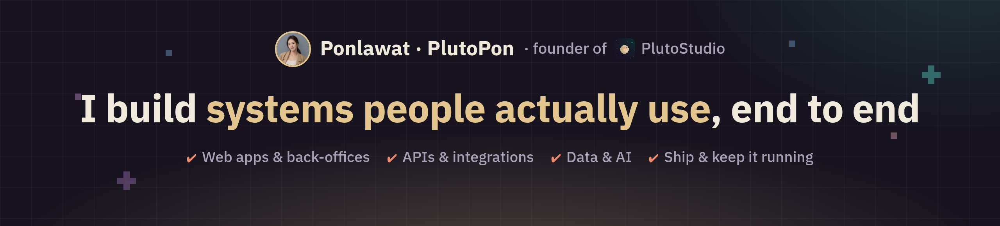

  

  <a href="#-highlight">Highlight</a> ·
  <a href="#-plutostudio">PlutoStudio</a> ·
  <a href="#-selected-work">Selected work</a> ·
  <a href="#-open-source--tools">Open source</a> ·
  <a href="#-stack">Stack</a> ·
  <a href="#-contact">Contact</a>

---

I build real systems end to end — design, code, ship to production, and keep them running afterwards.
Most of what PlutoStudio delivers is built by me: web apps and back-offices, APIs that talk to legacy
university and government systems, data pipelines, and AI features that do actual work.

## ⭐ Highlight

### [Rabbit Rewards](https://rewards.rabbit.co.th/)

Rabbit's rewards platform — *"Change every day to a reward"*. Freelance/contract work: I built the
customer-facing web and the backend/API end to end, and worked with Rabbit's R&amp;D team on internal
back-office modules. 
<a href="https://rewards.rabbit.co.th/">rewards.rabbit.co.th</a>

## 🪐 PlutoStudio

[PlutoStudio](https://github.com/PlutoStudio) is the small software studio I started. We build for
universities, public agencies and businesses in Thailand — from the first sketch to post-launch support.

## ✨ Selected work

<table>
  <tr>
    <td width="50%" valign="top">
      
      <h3>Planriean</h3>
      Class-schedule planner for university students: pick courses, catch time clashes, read course reviews,
      and see the campus map with walking times. Next.js front end, Go + Python services that sync with the
      university registration system. 
      <a href="https://www.planriean.com">planriean.com</a>
    </td>
    <td width="50%" valign="top">
      
      <h3>Group Sentinel</h3>
      AI assistant for Facebook group admins: screens posts and join requests, with insights and an audit log.
      Browser extension + backend + image ingest pipeline. 
      <a href="https://group-sen.plutopon.me">group-sen.plutopon.me</a>
    </td>
  </tr>
  <tr>
    <td width="50%" valign="top">
      
      <h3>WaterWise</h3>
      Province-level community water data system: overview map, water demand, surveyed sources and supply. 
      <a href="https://roiet-twc.greendev.app/dashboard">roiet-twc.greendev.app</a>
    </td>
    <td width="50%" valign="top">
      
      <h3>ลอยสุขไปต่อ — online Loy Krathong</h3>
      Seasonal campaign: decorate your own krathong, write a wish, float it with up to 4 friends,
      then save a shareable card. 
      <a href="https://www.planriean.com/loy">planriean.com/loy</a>
    </td>
  </tr>
  <tr>
    <td width="50%" valign="top">
      
      <h3>แม่ทองใบอมตะ</h3>
      Gold-shop website with today's gold price, products, promotions and branch map. 
      <a href="https://www.maethongbaigold.com/">maethongbaigold.com</a>
    </td>
    <td width="50%" valign="top">
      
      <h3>verDDC</h3>
      Daily/weekly machine-rental store with PromptPay top-up and remote power control over a relay switch. 
      Retired
    </td>
  </tr>
</table>

Also: a blood-bank system that syncs hospital blood-bag stock into a shared service (Windows agent + API
gateway), an intellectual-property database for Mahasarakham University, and a few more client projects
that live in private repos.

## 🧰 Open source & tools

| Project | What it is |
|---|---|
| [feature-books-plugin](https://github.com/PonlawatP/feature-books-plugin) | Claude Code plugin that keeps per-feature business rules and code fences in an Obsidian vault, to cut regressions as a project grows |
| [dev-tools-kit-plugin](https://github.com/PonlawatP/dev-tools-kit-plugin) | Reusable dev tools (Playwright e2e harness, log viewer, SSH) each shipped with the agent skill that drives it |
| [docs-n-slides-framework](https://github.com/PonlawatP/docs-n-slides-framework) | One `<script>` tag turns a plain HTML file into a dark technical doc that is also a slideshow |
| [true-screen](https://github.com/PonlawatP/true-screen) | GNOME/Wayland utility that lays out monitors by their real physical size so the pointer moves naturally |
| [plutopon-site](https://github.com/PonlawatP/plutopon-site) | My personal site — [plutopon.me](https://plutopon.me) |

Before all this I spent years writing Minecraft server plugins and infrastructure (account protection,
lobby, game modes) — that's where most of my Java came from.

## 🛠 Stack

  
  
  
  
  
  
  
  
  
  
  
  

## 📫 Contact

🌐 [plutopon.me](https://plutopon.me) ·
📷 [@pluto.pon](https://www.instagram.com/pluto.pon/) ·
📘 [Facebook](https://www.facebook.com/plganimation/) ·
✉️ [plgmcdesign@gmail.com](mailto:plgmcdesign@gmail.com)
